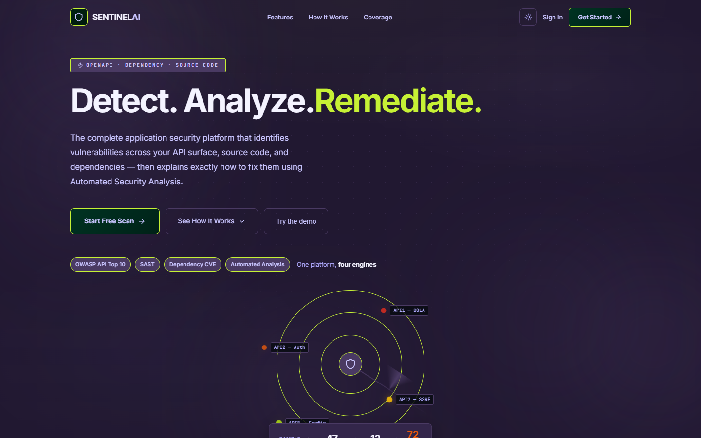

# SentinelAI

An OpenAPI, dependency, and source-file security scanner with deterministic rules. Upload one file — an API spec, a dependency manifest, or a source file — and get findings, a risk score, and a fix instruction for each.

[](https://github.com/shashu123456/SentinelAI/actions/workflows/ci.yml)
[](https://github.com/shashu123456/SentinelAI/tree/main/docs)
[](https://www.python.org/download/releases/3.11/)
[](LICENSE)

## Preview



A one-page recruiter walkthrough — live links, the 60-second demo path, screenshots,
architecture and the honest boundaries — is in
[docs/PROJECT-PREVIEW.md](docs/PROJECT-PREVIEW.md). The complete project reference,
including sample uploads, local setup and the three scanners, is in
[docs/PROJECT-DETAILS.md](docs/PROJECT-DETAILS.md).

## Try it

1. **Demo** — the landing page starts a read-only demo session with three seeded
   scans already in place
2. **Register** — or create your own account
3. **New scan** — one upload box: drop an OpenAPI spec, a dependency manifest, or
   source code / a project zip and the matching scanner runs
4. **Report** — view detected findings with severity, CWEs, and remediation hints

Live API: https://sentinelai-api.vercel.app  
Live Web: https://sentinelai-web.vercel.app

---

## Capabilities

| Check type | Input it reads | What actually runs |
|------------|----------------|--------------------|
| **OWASP API Security** | OpenAPI / Swagger spec (`.json`, `.yaml`, `.yml`) | 10 category checks, API1–API10, each mapped to a CWE |
| **SAST** | one source file, or a project `.zip` | 48 pattern rules: 23 Python, 14 JavaScript, 11 Java |
| **Dependency check** | manifest or lockfile (`requirements.txt`, `package.json`, `pom.xml`, lockfiles) | live **OSV.dev** advisories for PyPI, npm and Maven, merged with a small curated fallback table |

Rule counts are the lengths of the registries in the codebase:
`ALL_RULES` is 48 and the spec scanner covers `API1`–`API10`.

## What it does not do

- **No live-URL scanning.** It reads an uploaded file and never sends traffic to a
  host you name.
- **No full-repository scanning.** Archive scans are capped at 200 source files /
  2 MB; beyond that the scan returns a partial report with scanned/skipped counts.
- **No automatic fixing.** A finding includes a fix *instruction*; nothing is
  patched for you.
- **No exploitation or fuzzing.** No proof-of-concept payloads, auth-bypass proofs
  or input mutation.
- **No hosted LLM.** The Copilot the UI uses is rule-based (`app/core/copilot/` has
  no HTTP client). Optional self-hosted Ollama support exists only on the `/ai/*`
  platform endpoints, which the UI never calls and which cannot reach a model from
  the serverless deployment's default `localhost` address.
- **AgentGuard is not enabled.** The prompt-injection probe is not shipped in this
  build and is not reachable from the app.

Full detail: [docs/LIMITATIONS.md](docs/LIMITATIONS.md).

---

## Architecture

```mermaid
graph TD
  subgraph "Frontend (Vite + React)"
    UI -->|spec / deps / code| API
  end
  subgraph "Backend (FastAPI)"
    API -->|Scan orchestration| Engine
    Engine -->|SAST| Python parser
    Engine -->|OpenAPI analysis| Spec analyzer
    Engine -->|Dep scan| Package index
    Engine -->|Report generation| Markdown/HTML
  end
  subgraph "Data (Postgres in production; SQLite in dev/test)"
    Engine -->|Results| DB
  end
```

---

## Limits

- **Upload ceiling** — 5 MB per upload in the application. On Vercel the platform
  body limit can reject a request before that check runs, returning its own `413`.
- **Serverless budget** — the API runs on Vercel with a ~10 s function budget, so a
  large input returns `200` with `partial: true` instead of a gateway timeout.
- **Dependency freshness** — OSV results are cached in memory for up to 1 hour, so a
  brand-new advisory can lag by up to an hour. The only outbound call is
  `api.osv.dev`.
- **SAST is pattern-based** — no data-flow or taint analysis; false positives and
  false negatives are expected. Treat a finding as a lead, not a verdict.
- **Trust gate** — scanning requires accepting the authorized-use terms: only scan
  material you own or have written permission to test.

Deploy: see [docs/DEPLOYMENT-GUIDE.md](docs/DEPLOYMENT-GUIDE.md)  
Verification record for the current build: [docs/EVIDENCE-FINAL.md](docs/EVIDENCE-FINAL.md)

---

## Badges

- CI: [](https://github.com/shashu123456/SentinelAI/actions/workflows/ci.yml)
- CodeQL: [](https://github.com/shashu123456/SentinelAI/tree/main/docs)
- Python: [](https://www.python.org/downloads/release/python-3110/)
- License: [](LICENSE)
