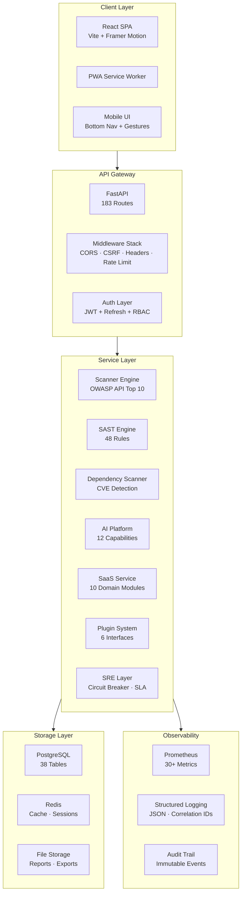
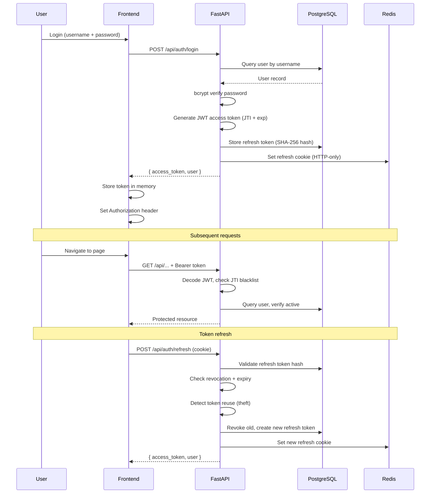
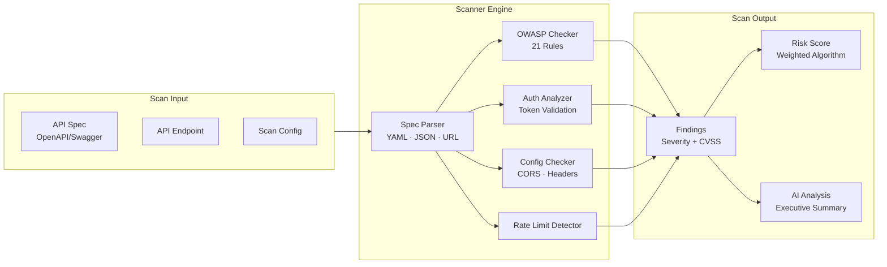
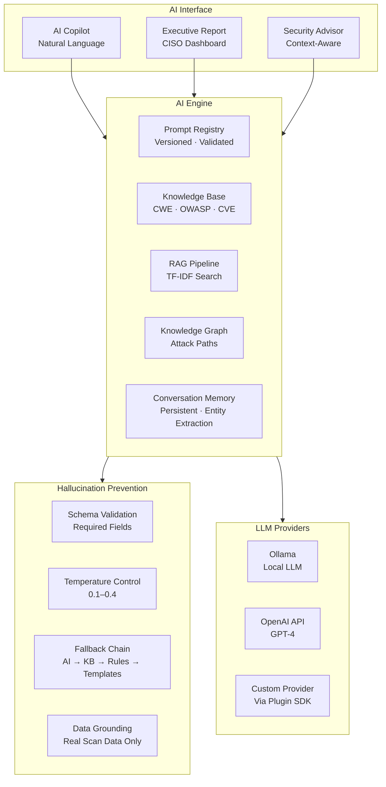
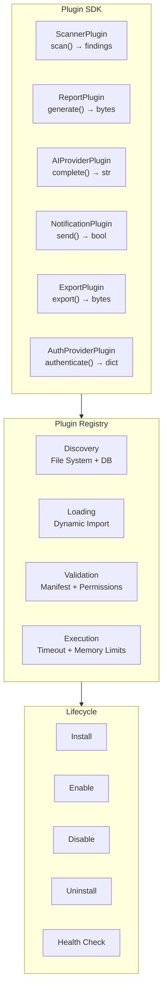
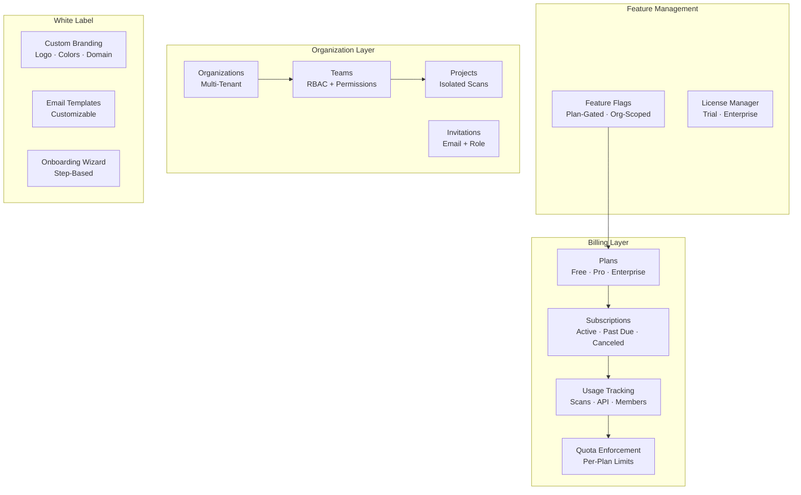
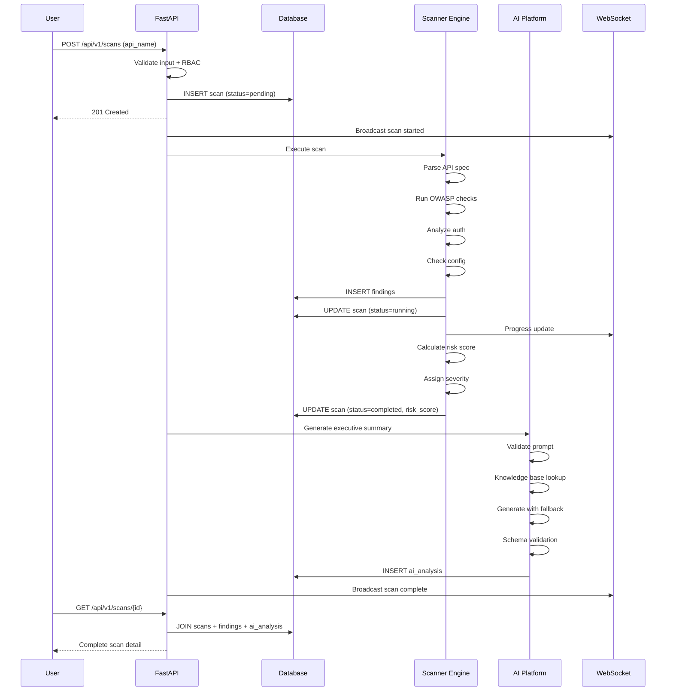

# SentinelAI Architecture Diagrams

## System Architecture



## Authentication Flow



## Scanner Engine Architecture



## AI Platform Architecture



## Plugin System Architecture



## SaaS Architecture



## Data Flow: Scan Lifecycle



## Folder Structure

```
sentinelai/
├── backend/
│   ├── app/
│   │   ├── api/routes/          # 15 route modules (183 endpoints)
│   │   ├── core/
│   │   │   ├── ai_platform/     # AI engine, knowledge base, prompts
│   │   │   ├── copilot/         # AI copilot agent
│   │   │   ├── plugins/         # Plugin SDK, registry, examples
│   │   │   ├── security_engine/ # OWASP scanner
│   │   │   ├── sast_engine/     # Static analysis
│   │   │   └── dep_scanner/     # Dependency scanning
│   │   ├── database/            # Engine, session, query monitor, migrations
│   │   ├── models/              # SQLAlchemy models (4 modules)
│   │   ├── repositories/        # Data access layer
│   │   ├── schemas/             # Pydantic schemas (6 domain modules)
│   │   ├── services/            # Business logic (saas/, audit, etc.)
│   │   ├── utils/               # Security, RBAC, tracing, SLA, etc.
│   │   └── tasks.py             # Background task registry
│   ├── alembic/versions/        # Database migrations
│   ├── tests/                   # 33 test files
│   └── Dockerfile
├── frontend/
│   ├── src/
│   │   ├── components/          # 20+ shared components
│   │   ├── pages/               # 30+ route pages
│   │   ├── contexts/            # Auth, Theme contexts
│   │   └── services/            # API client, config
│   └── Dockerfile
├── docker-compose.yml           # 10-service stack
├── .github/workflows/           # CI/CD pipeline
├── terraform/                   # AWS deployment
└── docs/                        # 14 documentation files
```
