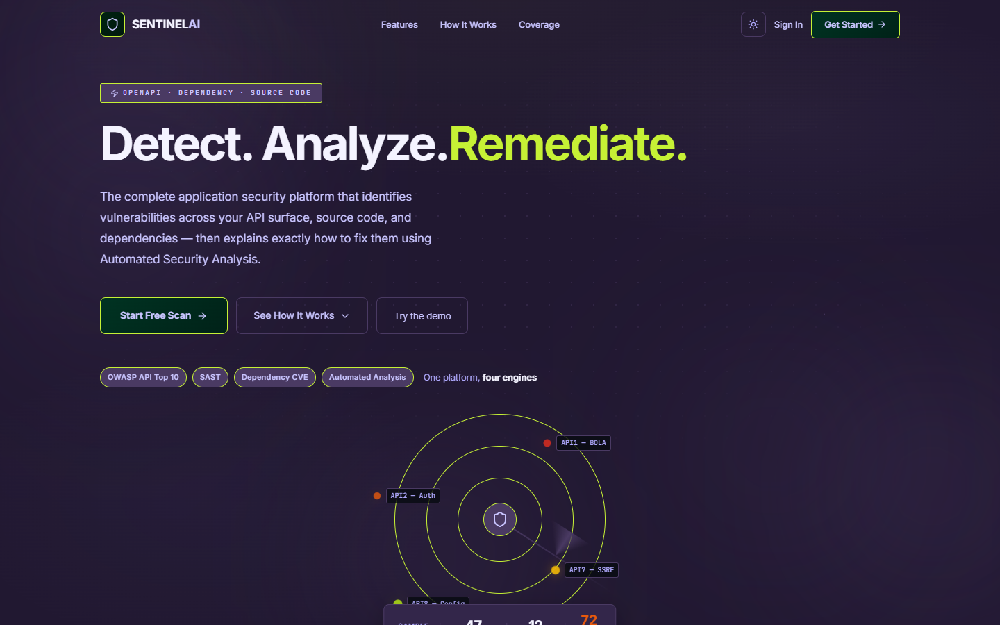
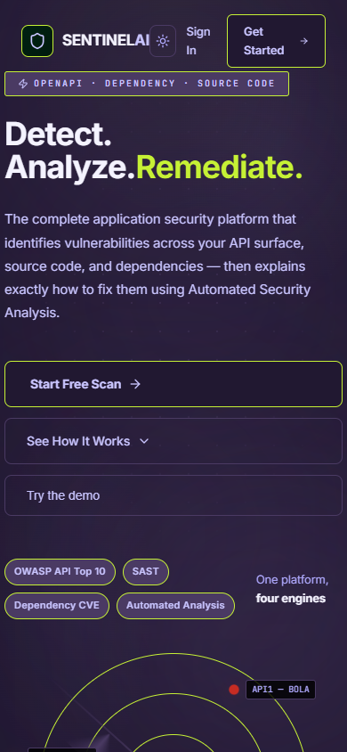
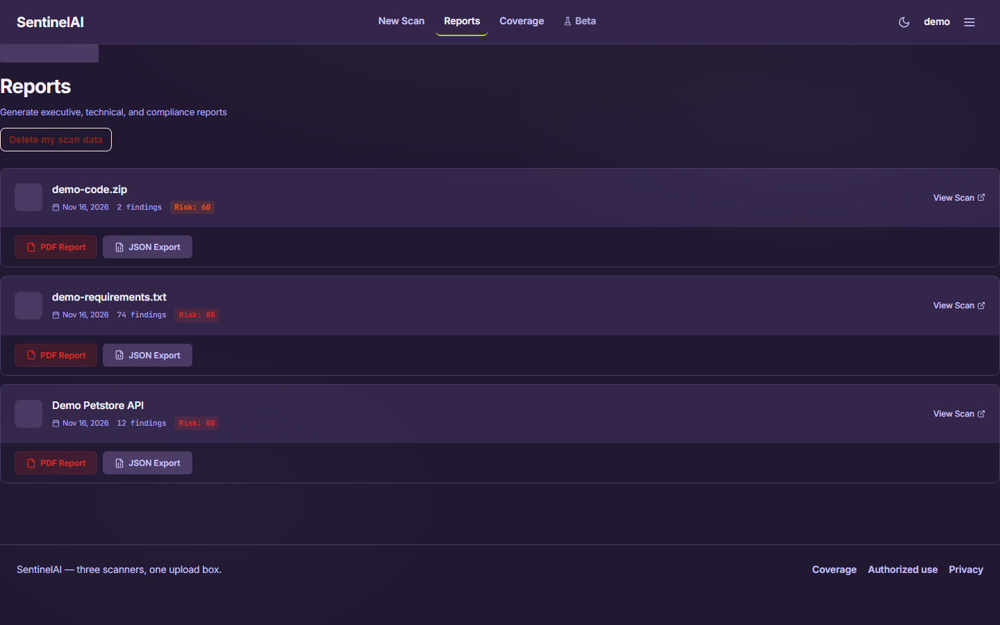
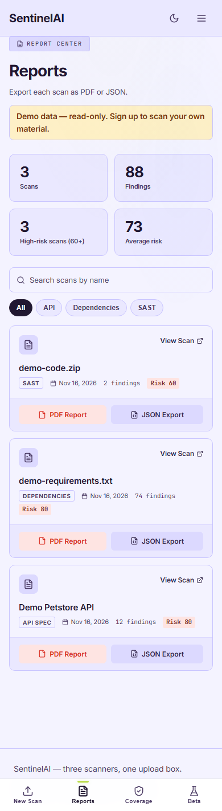
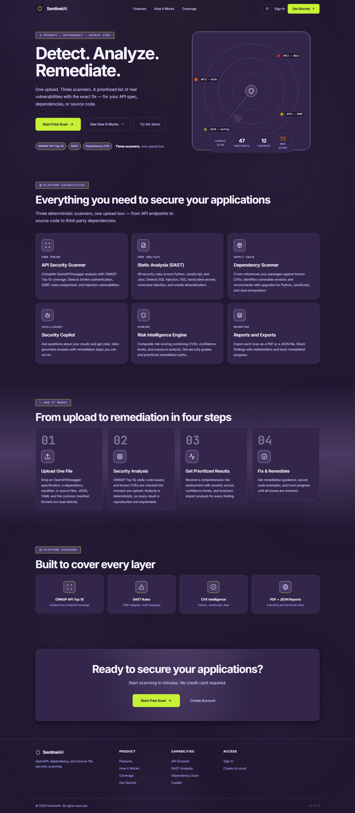
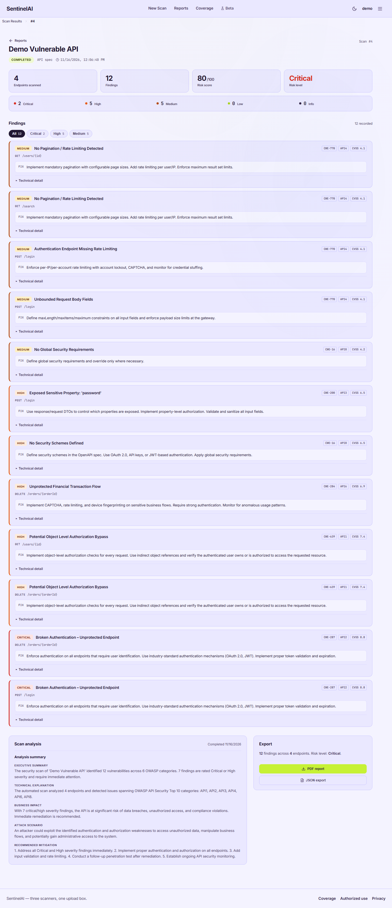
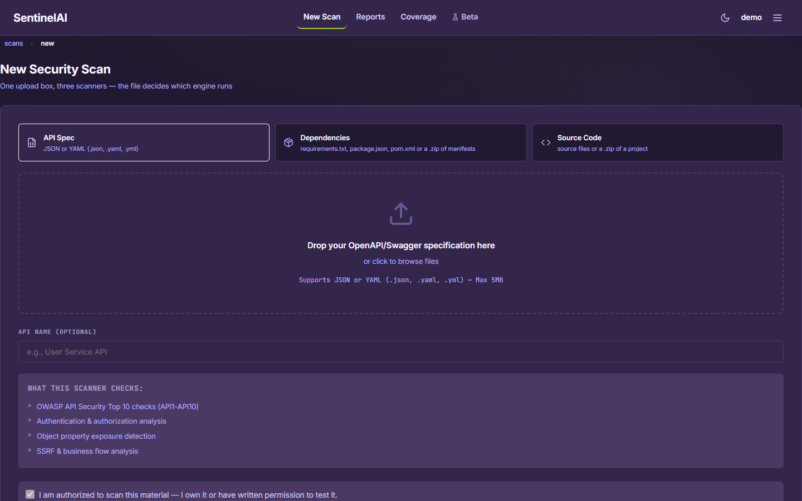
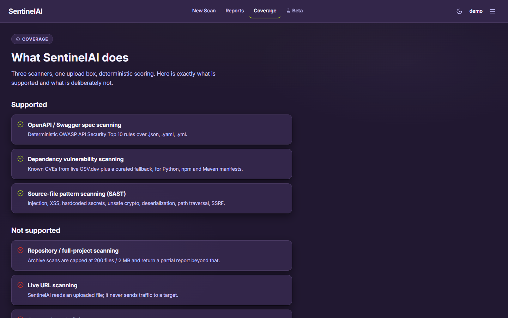
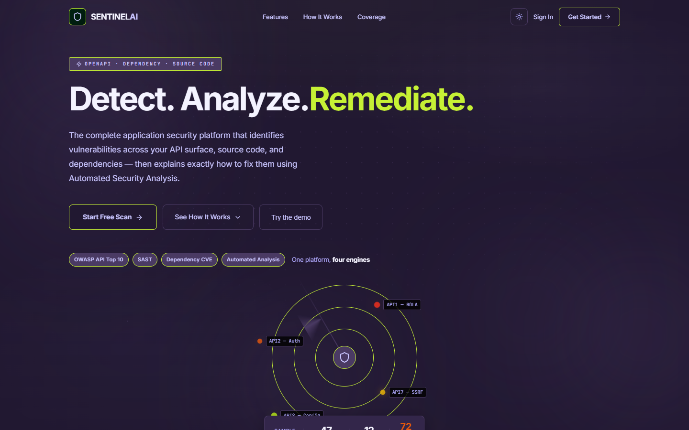

# SentinelAI — Project Preview

**One line:** SentinelAI is a deployed application-security scanner that reads one
uploaded file — an OpenAPI spec, a dependency manifest, or source code — and returns
prioritized, reproducible findings with a fix instruction for each.

| | |
|---|---|
| Live web | https://sentinelai-web.vercel.app |
| API health | https://sentinelai-api.vercel.app/api/health — HTTP 200 |
| API version | https://sentinelai-api.vercel.app/api/v1/version |
| Source | https://github.com/shashu123456/SentinelAI |
| CI | [run 44354201085](https://github.com/shashu123456/SentinelAI/actions/runs/44354201085) — 8/8 jobs green |

> The health route is `/api/health` (or `/api/v1/health`). `/health` returns 404 —
> verified against the live API on 2026-11-18.
>
> Screenshots and measurements were captured from the deployed `70c6fef` build, when
> the live API reported `70c6fef`. If a later docs-only commit changes the live SHA,
> the app code is still `70c6fef`; the served bundle hash (`index-0z65gU5H.js`) is
> what proves the page did not change.

## What it does

- One upload box decides the scanner: the file type selects spec, dependency, or
  SAST analysis — there is nothing to configure and no target URL to enter.
- Every finding carries a severity, a CWE/CVSS-style score, the affected endpoint or
  file, and a concrete remediation instruction rather than a vague warning.
- Results are deterministic: the same file produces the same findings and the same
  risk score, so a re-run is a regression check rather than a gamble.
- Each scan exports as PDF or JSON for sharing or tracking.

### The three scanners

| Scanner | Input it reads | What actually runs |
|---|---|---|
| API spec | OpenAPI/Swagger `.json`, `.yaml`, `.yml` | 10 OWASP API Top 10 checks, API1–API10, each mapped to a CWE |
| Dependencies | `requirements.txt`, `package.json`, `pom.xml`, lockfiles | live **OSV.dev** advisories (PyPI, npm, Maven) merged with a curated fallback |
| SAST | one source file, or a project `.zip` | 48 pattern rules: 23 Python, 14 JavaScript, 11 Java |

"Source Code" in the UI is the **input** to the SAST scanner. There is no fourth
engine.

## 60-second demo path

1. Open https://sentinelai-web.vercel.app. The landing is light (Periwinkle Bloom)
   by default; the moon/sun button switches themes and the choice is remembered.
2. Click **Try the demo**. This starts a read-only session — no sign-up, no password.
3. You land on **Reports**, which already holds three seeded scans: an API spec
   (`Demo Petstore API`), a dependency manifest (`demo-requirements.txt`) and source
   code (`demo-code.zip`). The KPI strip reads 3 scans / 88 findings / 3 high-risk /
   73 average risk.
4. Open **Demo Petstore API**. The summary shows 4 endpoints, 12 findings and risk
   80 (Critical), then a severity breakdown, a filterable findings list with the fix
   line for each issue, and collapsed technical detail.
5. Go back to **Reports** and press **PDF Report** on any card; **JSON Export** sits
   next to it. The demo is read-only, so the delete/danger zone is hidden.

## Screenshots

All captured from the deployed site at DPR 1, after the `70c6fef` build.

**Landing — desktop**



**Landing — mobile (390px)**



**Reports — desktop**: KPI strip, search, kind filter, three seeded scans.



**Reports — mobile**: stacked cards, bottom navigation.



**Landing — dark theme**: `sentinelai-theme=dark` written to storage and the page
reloaded; `data-theme="dark"`, body `rgb(33, 24, 49)`, feature cards `rgb(55, 42, 78)`.



**Scan detail**: summary and severity breakdown above the findings, fix instruction
visible, technical detail collapsed.



**New scan**: one upload box, three scanner tiles, SAST labelled as source code.



**Coverage**: what each scanner checks and what is deliberately out of scope.



## Architecture

```
Browser (React 18 + Vite)
   |
   | HTTPS, JWT bearer token
   v
FastAPI (Python 3.11, SQLAlchemy 2, Pydantic)
   |-- spec scanner      deterministic OWASP API1–API10 rules
   |-- dependency scan   OSV.dev advisories + curated fallback
   |-- SAST engine       48 pattern rules, 200 files / 2 MB cap
   |-- risk engine       severity + CVSS-style score -> risk level
   `-- report/export     findings -> PDF or JSON
   |
   v
PostgreSQL (Neon in production, SQLite in dev/test)

Frontend and API deploy separately on Vercel; GitHub Actions runs
tests, mypy/ruff/black, CodeQL (python + javascript), Gitleaks,
a Docker build, and a post-deploy smoke test.
```

## Proof

| Evidence | Value |
|---|---|
| CI run | 44354201085 on `70c6fef` — 8/8 jobs green (backend tests, backend lint & type check, frontend test & build, CodeQL python, CodeQL javascript, secret scanning, Docker build, deployment smoke) |
| Backend tests | 1,090 passed / 2 skipped in the last full local run (`docs/EVIDENCE-FINAL.md` §7); the CI `Backend tests` job is green |
| Frontend tests | 35 passed / 35 (`npm test` in `frontend`) |
| Live API | `/api/v1/version` returned commit `70c6fef` at the time of this file |
| HTTP surface | 182 route decorators (`@router.get|post|put|patch|delete`) across the routers in `backend/app/api` |
| Screenshots | 15 files in `docs/screenshots`; the 12 current page captures are listed in `docs/EVIDENCE-FINAL.md` §11 with pixel dimensions and colour counts |

## Honest boundaries

- **Three scanners only** — API spec, dependencies, SAST. Source code is SAST input,
  not a fourth engine.
- **Rule-based Copilot** — it answers from stored scan results and a rules table.
  There is no hosted LLM and the UI never calls the optional `/ai/*` endpoints.
- **No live-URL scanning** — the tool reads an uploaded file and never sends traffic
  to a host you name.
- **No full-repository scanning** — archives are capped at 200 source files / 2 MB;
  past that a scan returns `partial: true` with scanned/skipped counts.
- **No autofix** — findings include a fix instruction; nothing is patched.
- **AgentGuard is not enabled** — the prompt-injection probe is documented but not
  shipped or reachable in this build.
- The demo account is read-only; organisation/team and Beta routes exist in the app
  but are not part of this demo path.

## Before / after

Before this pass the app defaulted to a dark theme and the hero visual sat inside the
text column, so the page read as a single faint column.



*Before — capture from commit `87c2968`, default dark theme, 1440x900 viewport.*


*After — capture from the deployed `70c6fef` build, full page at 1440px: two-column
hero with a 480px radar panel, white cards on bloom surfaces, volt only on actions.*
