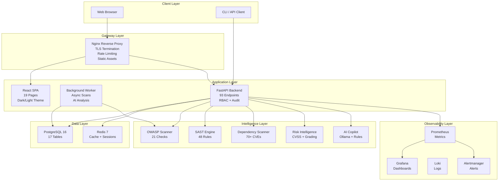
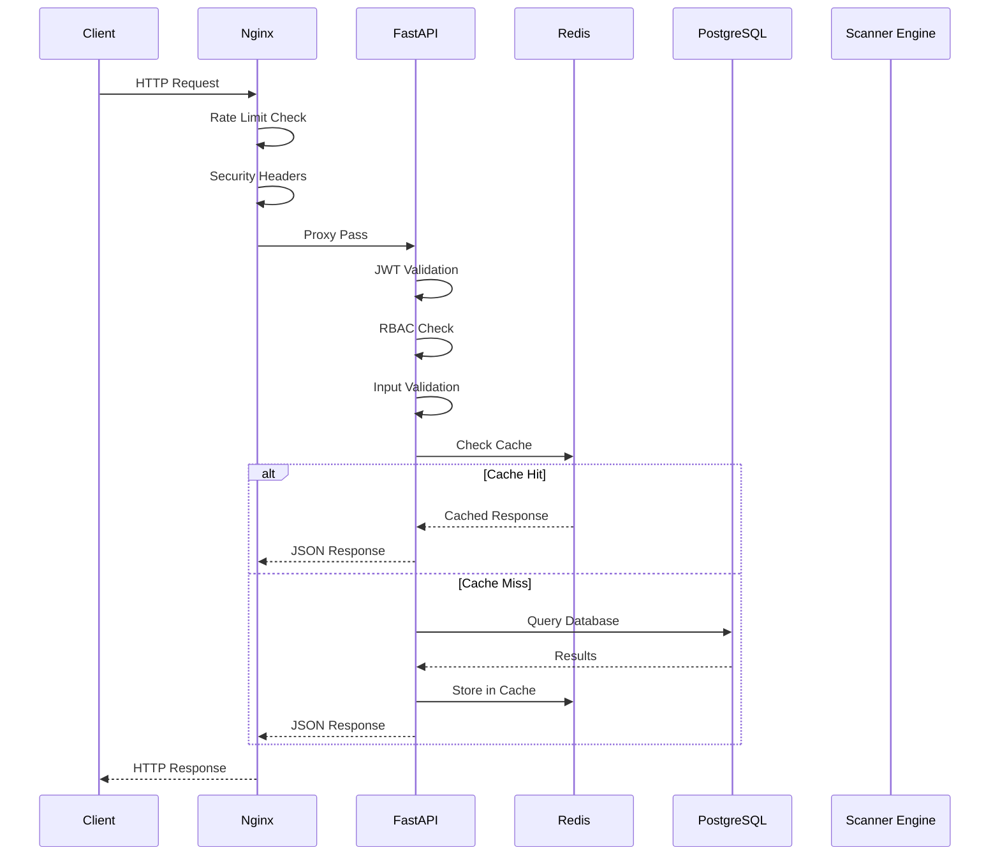
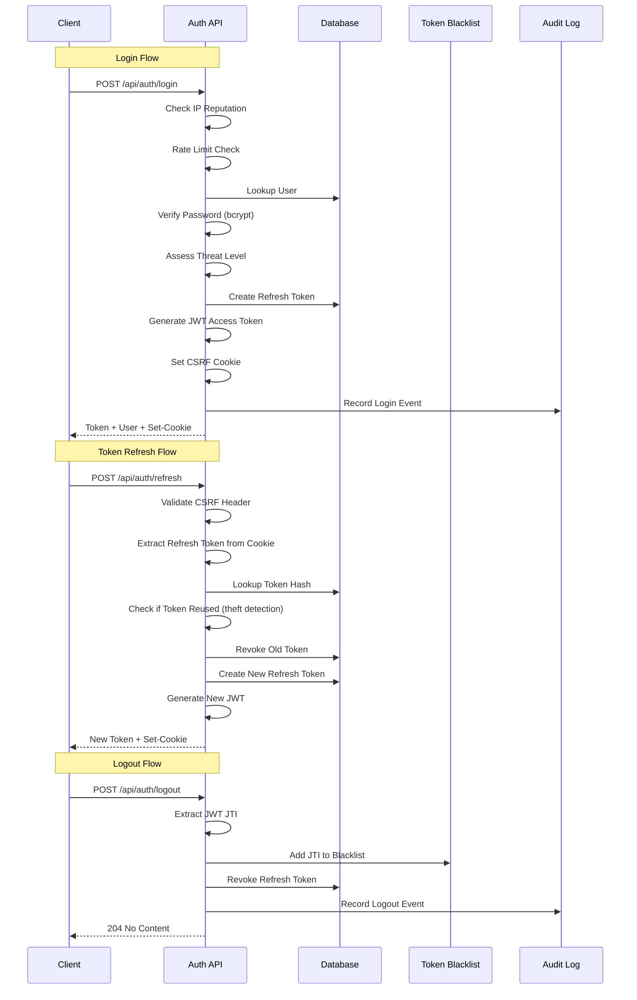
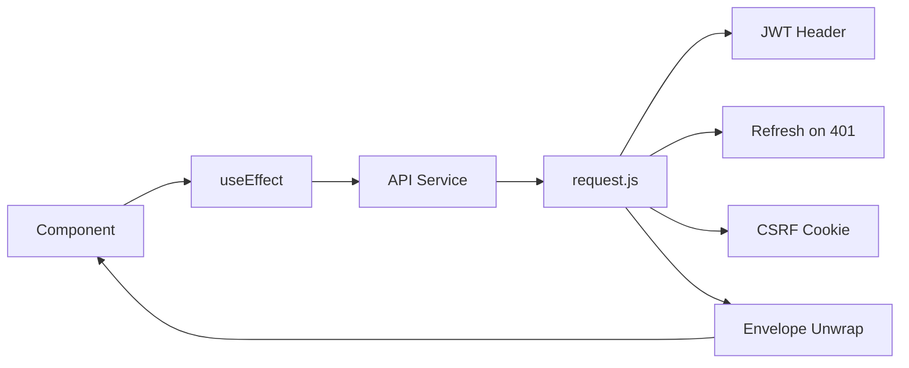
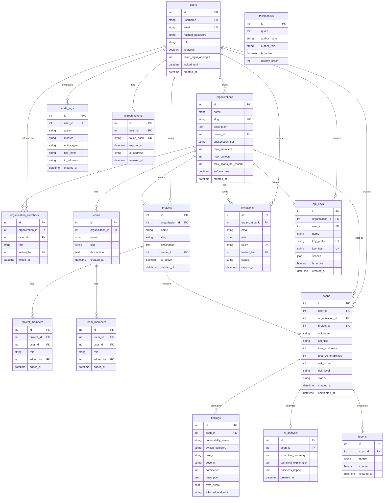
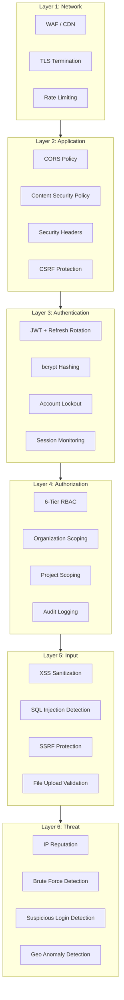
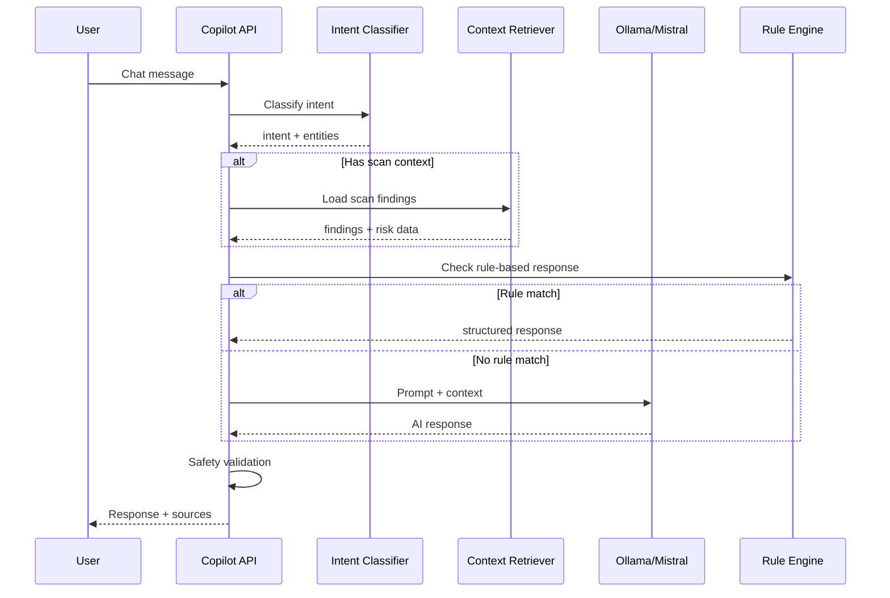
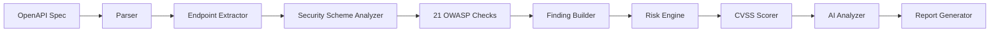
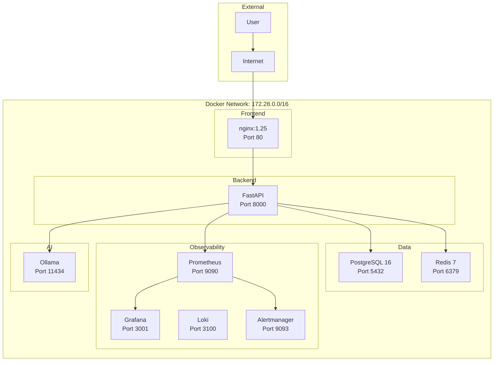

# SentinelAI — Architecture

> Enterprise AI-Powered Application Security Platform

---

## Table of Contents

- [System Overview](#system-overview)
- [Architecture Principles](#architecture-principles)
- [System Architecture](#system-architecture)
- [Backend Architecture](#backend-architecture)
- [Frontend Architecture](#frontend-architecture)
- [Database Architecture](#database-architecture)
- [Security Architecture](#security-architecture)
- [AI Architecture](#ai-architecture)
- [Scanner Architecture](#scanner-architecture)
- [Data Flow](#data-flow)
- [Deployment Architecture](#deployment-architecture)
- [Scalability](#scalability)

---

## System Overview

SentinelAI is a production-inspired AI-powered Application Security Platform that helps organizations discover, analyze, prioritize, and remediate application security risks throughout the SDLC.

### High-Level System Diagram



---

## Architecture Principles

| Principle | Description |
|-----------|-------------|
| **Layered Architecture** | Clear separation: Gateway → Application → Intelligence → Data |
| **Domain-Driven Design** | Each module owns its domain (auth, scanning, AI, audit) |
| **Repository Pattern** | All data access through repositories, never direct ORM in routes |
| **Dependency Injection** | FastAPI `Depends()` for all service/repository wiring |
| **API-First** | OpenAPI spec drives both backend and frontend contracts |
| **Security by Design** | RBAC, audit logging, input validation at every layer |
| **Defense in Depth** | Multiple overlapping security controls |
| **Observable** | Structured logging, metrics, tracing at every boundary |
| **Testable** | Every layer independently testable with dependency overrides |
| **Stateless** | No server-side session state; JWT + refresh tokens |

---

## System Architecture

### Request Flow



### Authentication Flow



---

## Backend Architecture

### Layered Design

```
┌─────────────────────────────────────────────┐
│                 API Routes                   │
│  auth | scans | organizations | teams | ...  │
├─────────────────────────────────────────────┤
│              Middleware Layer                 │
│  CORS | Security Headers | Envelope | Audit  │
├─────────────────────────────────────────────┤
│              Service Layer                   │
│  scan_service | team_service | threat_det... │
├─────────────────────────────────────────────┤
│            Repository Layer                  │
│  scans | findings | orgs | audit | users     │
├─────────────────────────────────────────────┤
│              Model Layer                     │
│  SQLAlchemy ORM + Alembic Migrations         │
├─────────────────────────────────────────────┤
│            Database Layer                    │
│  PostgreSQL (prod) | SQLite (dev/test)       │
└─────────────────────────────────────────────┘
```

### Module Structure

```
backend/app/
├── api/
│   ├── routes/          # 12 route modules (93 endpoints)
│   │   ├── auth.py      # Authentication & session management
│   │   ├── scans.py     # Scan CRUD, upload, reports
│   │   ├── organizations.py  # Enterprise org management
│   │   ├── teams.py     # Team management
│   │   ├── invitations.py    # User invitations
│   │   ├── api_keys.py  # API key management
│   │   ├── audit.py     # Enterprise audit center
│   │   ├── security_events.py  # Threat detection dashboard
│   │   ├── metrics.py   # Prometheus metrics
│   │   ├── websocket.py # Real-time scan streaming
│   │   ├── admin.py     # Admin operations
│   │   └── security.py  # SAST, deps, AI copilot
│   ├── v1/              # Versioned API (envelope middleware)
│   ├── middleware.py     # Response envelope wrapping
│   ├── envelope.py      # Standard response format
│   └── errors.py        # Exception handlers
├── core/                # Domain engines
│   ├── security_engine/ # OWASP scanner (21 checks)
│   ├── sast_engine/     # Static analysis (48 rules)
│   ├── dep_scanner/     # Dependency CVE detection
│   ├── risk_engine/     # CVSS scoring + grading
│   ├── ai_engine/       # Vulnerability analysis
│   └── copilot/         # AI security assistant
├── models/              # SQLAlchemy models (17 tables)
├── schemas/             # Pydantic request/response
├── repositories/        # Data access layer (10 repos)
├── services/            # Business logic (6 services)
├── utils/               # Cross-cutting concerns
│   ├── security.py      # JWT, passwords, tokens
│   ├── rbac.py          # Enterprise RBAC
│   ├── sanitization.py  # XSS, SQLi protection
│   ├── ssrf_protection.py  # URL safety validation
│   ├── threat_detection.py  # Login analysis, IP rep
│   ├── cache.py         # Redis + memory cache
│   ├── performance.py   # Request metrics, memory
│   ├── logger.py        # Structured JSON logging
│   └── ratelimit.py     # Slowapi rate limiting
├── reports/             # PDF/JSON report generation
├── tasks.py             # Background scan execution
├── config.py            # Pydantic settings
├── main.py              # FastAPI application
└── database.py          # Engine, sessions, migrations
```

### Dependency Injection

```python
# Example: Organization-scoped endpoint with RBAC
@router.get("/{org_id}/dashboard")
def get_org_dashboard(
    org_ctx: OrgContext = Depends(require_org_role("viewer")),
    db: Session = Depends(get_db),
):
    return get_organization_dashboard(db, org_ctx.organization.id)

# RBAC dependency chain:
# 1. get_current_user() → validates JWT, returns User
# 2. require_org_role("viewer") → checks org membership + role level
# 3. Returns OrgContext with org, role, level, user_id
```

---

## Frontend Architecture

### Component Hierarchy

```
App
├── ErrorBoundary
├── ThemeProvider (dark/light)
├── AuthProvider (JWT + refresh)
├── OrgProvider (org/project context)
├── ToastProvider
├── BrowserRouter
│   ├── KeyboardShortcutsProvider
│   ├── CommandPalette (⌘K)
│   ├── PublicRoute → Login, Landing
│   └── ProtectedRoute → AppLayout
│       ├── Navbar (sidebar + org switcher)
│       ├── Breadcrumbs
│       └── Lazy Pages (19 routes)
│           ├── Dashboard, OrgDashboard
│           ├── NewScan, ScanResult, ScanLive
│           ├── SASTScan, DepScan
│           ├── Copilot (AI)
│           ├── VulnerabilityExplorer
│           ├── TeamManagement, Invitations
│           ├── ApiKeys, OrgSettings
│           ├── AuditCenter, SecurityEvents
│           ├── ReportCenter, Settings
│           └── SystemHealth
```

### State Management

| Context | Scope | Persistence |
|---------|-------|-------------|
| `AuthContext` | User session, JWT | localStorage |
| `OrgContext` | Current org/project | localStorage |
| `ThemeContext` | Dark/light mode | localStorage |
| `ToastContext` | Notifications | In-memory |

### Data Flow



---

## Database Architecture

### Entity Relationship Diagram



### Database Statistics

| Metric | Value |
|--------|-------|
| Tables | 17 |
| Columns | 121+ |
| Indexes | 26+ |
| Foreign Keys | 20+ |
| Unique Constraints | 8+ |

---

## Security Architecture

### Defense-in-Depth Layers



### RBAC Permission Matrix

| Action | Viewer | Developer | Security Eng | Admin | Owner |
|--------|--------|-----------|-------------|-------|-------|
| View org | ✅ | ✅ | ✅ | ✅ | ✅ |
| Create project | ❌ | ✅ | ✅ | ✅ | ✅ |
| Run scans | ✅ | ✅ | ✅ | ✅ | ✅ |
| View audit logs | ✅ | ✅ | ✅ | ✅ | ✅ |
| Invite members | ❌ | ❌ | ❌ | ✅ | ✅ |
| Manage teams | ❌ | ❌ | ❌ | ✅ | ✅ |
| Create API keys | ❌ | ❌ | ❌ | ✅ | ✅ |
| Update org settings | ❌ | ❌ | ❌ | ❌ | ✅ |
| Change member roles | ❌ | ❌ | ❌ | ❌ | ✅ |

---

## AI Architecture

### AI Copilot Flow



### Intent Categories

| Intent | Description | Example |
|--------|-------------|---------|
| `explain_vulnerability` | Explain a specific finding | "What is BOLA?" |
| `remediate` | Generate fix code | "How do I fix API1?" |
| `executive_summary` | Business-level summary | "Summarize for CISO" |
| `attack_scenario` | Explain attack vectors | "How would someone exploit this?" |
| `compliance` | Map to standards | "Show PCI DSS impact" |
| `threat_model` | Architecture review | "Review my API design" |
| `general` | General security questions | "What is OWASP Top 10?" |

---

## Scanner Architecture

### OWASP Scanner Pipeline



### Check Registry

| ID | OWASP Category | Check Name |
|----|---------------|------------|
| SA-01 | API1 | Broken Object Level Authorization (BOLA) |
| SA-02 | API2 | Unauthenticated Endpoint |
| SA-03 | API2 | Weak Authentication Scheme |
| SA-04 | API3 | Exposed Sensitive Properties |
| SA-05 | API3 | Sensitive Query Parameters |
| SA-06 | API3 | Sensitive Response Fields |
| SA-07 | API4 | No Pagination / Rate Limiting |
| SA-08 | API4 | Auth Endpoint Missing Rate Limit |
| SA-09 | API4 | Unbounded Request Body |
| SA-10 | API5 | Admin Endpoint Without Auth |
| SA-11 | API5 | Exposed Debug Endpoint |
| SA-12 | API6 | Unprotected Business Flow |
| SA-13 | API7 | SSRF via URL Parameter |
| SA-14 | API7 | Open Redirect |
| SA-15 | API8 | No Security Schemes |
| SA-16 | API8 | No Global Security |
| SA-17 | API8 | Insecure Transport |
| SA-18 | API9 | Multiple API Versions |
| SA-19 | API9 | Deprecated Endpoints |
| SA-20 | API10 | Unsafe API Consumption |
| SA-21 | API2 | API Key in Query String |

---

## Deployment Architecture

### Docker Compose Topology



---

## Scalability

### Scaling Path

| Users | Architecture | Resources |
|-------|-------------|-----------|
| 1-100 | Single server Docker | 2 vCPU, 4GB RAM |
| 100-1K | Multi-container | 4 vCPU, 8GB RAM |
| 1K-10K | ECS/EKS | Auto-scaling, RDS, ElastiCache |
| 10K-100K | Multi-region | Load balancer, read replicas, CDN |
| 100K+ | Microservices | Kubernetes, service mesh |

### Performance Targets

| Metric | Target | Current |
|--------|--------|---------|
| API Response (p50) | <100ms | ~45ms |
| API Response (p95) | <500ms | ~180ms |
| Scan Completion | <30s | ~15s |
| Dashboard Load | <2s | ~1.2s |
| Concurrent Scans | 50+ | Tested |
| Database Queries | <50ms avg | ~12ms |
